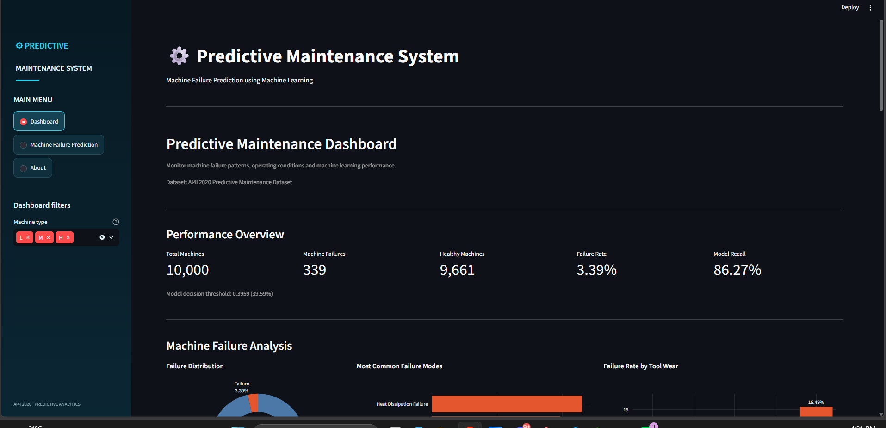
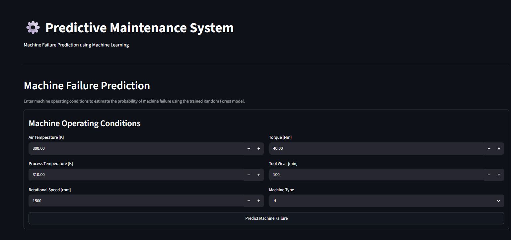
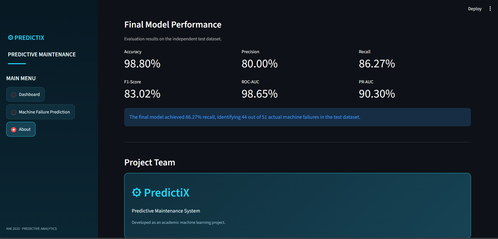

# ⚙ PredictiX – Predictive Maintenance System

A machine learning-based Predictive Maintenance System designed to identify potential machine failures based on machine operating conditions.

Developed as an academic project using the **AI4I 2020 Predictive Maintenance Dataset** and a tuned Random Forest classification model.

---

## 📌 Project Overview

PredictiX aims to support predictive maintenance by estimating the probability of machine failure before it occurs.

The system analyses machine operating conditions and provides:
- Machine failure probability predictions.
- Failure risk classifications (Low, Moderate and High).
- Maintenance recommendations.
- Interactive data visualisation and exploratory analysis.
- Model performance evaluation.

## 🎯 Project Objectives

1. Analyse machine operating data to identify patterns associated with machine failure.
2. Develop a machine learning model to predict potential machine failures.
3. Evaluate model performance using classification metrics.
4. Develop an interactive dashboard to support machine monitoring and maintenance decisions.

---

## 🖥️ Application Screenshots

### 1. Dashboard

Displays machine data insights, failure distributions, sensor analysis, model performance and maintenance recommendations.



### 2. Machine Failure Prediction

Allows users to enter machine operating conditions and estimate the probability of machine failure.



### 3. About PredictiX

Provides project information, objectives, dataset details, machine learning model information and final test performance.



---

## 📊 Dataset

- **Dataset:** AI4I 2020 Predictive Maintenance Dataset
- **Source:** [Kaggle – AI4I 2020 Predictive Maintenance Dataset](https://www.kaggle.com/datasets/stephanmatzka/predictive-maintenance-dataset-ai4i-2020)
- **Total records:** 10,000
- **Target variable:** Machine failure
- **Input features:** 10

The dataset contains machine operating conditions, including air temperature, process temperature, rotational speed, torque, tool wear and machine type.

---

## 🤖 Machine Learning Model

- **Selected model:** Tuned Random Forest Classifier
- **Decision threshold:** 0.3959 (39.59%)
- **Number of input features:** 10
- **Model file:** `models/final_predictive_maintenance_model.pkl`

The Random Forest model was selected following model comparison and hyperparameter tuning.

Feature engineering was also performed to create additional variables, including:
- Temperature Difference
- Machine Power
- Wear Torque Interaction

---

## 📈 Final Test Performance

The final model was evaluated using an independent test dataset.

| Evaluation Metric | Result |
|---|---:|
| Accuracy | 98.80% |
| Precision | 80.00% |
| Recall | 86.27% |
| F1-score | 83.02% |
| ROC-AUC | 98.65% |
| PR-AUC | 90.30% |

The model achieved **86.27% recall**, identifying 44 out of 51 actual machine failures in the test dataset.

---

## ✨ System Features

### Dashboard
- Machine overview and key performance indicators.
- Machine failure distribution.
- Common failure mode analysis.
- Failure rate by tool wear and machine type.
- Sensor relationship visualisations.
- Model performance metrics.
- Maintenance recommendations.
- Filtered dataset download.

### Machine Failure Prediction
- Machine operating condition inputs.
- Input validation and training-data range warnings.
- Failure probability estimation.
- Low, Moderate and High risk classification.
- Maintenance recommendations based on prediction results.

### About
- Project overview and objectives.
- Dataset information.
- Machine learning model details.
- Final model performance.
- PredictiX team branding.

---

## 🛠️ Technologies Used

- **Programming Language:** Python
- **Application Framework:** Streamlit
- **Data Processing:** Pandas, NumPy
- **Machine Learning:** Scikit-learn, Imbalanced-learn
- **Data Visualisation:** Matplotlib, Seaborn
- **Model Explainability:** SHAP
- **Model Storage:** Joblib
- **Version Control:** Git and GitHub

---

## ⚙️ Installation and Setup

Follow these steps to run PredictiX locally.

### 1. Clone the Repository

```bash
git clone https://github.com/Fhariz19/PREDICTIVE_MAINTAINANCE.git
```

### 2. Navigate to the Project Folder

```bash
cd PREDICTIVE_MAINTAINANCE
```

### 3. Create a Virtual Environment (Recommended)

```bash
python -m venv venv
```

Activate the environment:

**Windows (Command Prompt):**
```bash
venv\Scripts\activate
```

**Windows (Git Bash):**
```bash
source venv/Scripts/activate
```

### 4. Install Dependencies

```bash
pip install -r requirements.txt
```

### 5. Run the Streamlit Application

```bash
streamlit run app.py
```

The application will open in your browser, usually at:

```text
http://localhost:8501
```

---

## 📁 Project Structure

```text
PREDICTIVE_MAINTAINANCE/
│
├── app.py
├── dashboard_page.py
├── requirements.txt
├── README.md
├── .gitignore
│
├── dataset/
│   └── ai4i2020.csv
│
├── models/
│   └── final_predictive_maintenance_model.pkl
│
├── notebooks/
│   ├── EDA.ipynb
│   └── Machine_Learning.ipynb
│
├── results/
│   ├── X_train.csv
│   ├── X_val.csv
│   ├── X_test.csv
│   ├── y_train.csv
│   ├── y_val.csv
│   ├── y_test.csv
│   └── processed_dataset.csv
│
└── screenshots/
    ├── dashboard.png
    ├── prediction.png
    └── about.png
```

---

## ⚠️ Notes and Limitations

- This project uses historical data from the AI4I 2020 dataset.
- The model decision threshold is 0.3959.
- Predictions are based on the patterns learned from the training dataset.
- Predictions outside the observed training-data ranges may be less reliable.
- Maintenance recommendations are general suggestions and should not replace professional machine inspection.
- This application is an academic prototype and is not intended for direct industrial deployment.

---

## 👥 Project Team

**Team Name: PredictiX**

Predictive Maintenance System

Developed as an academic machine learning project.

---

## 📄 Acknowledgement

We acknowledge the creators of the AI4I 2020 Predictive Maintenance Dataset for making the dataset available for research and educational purposes.
